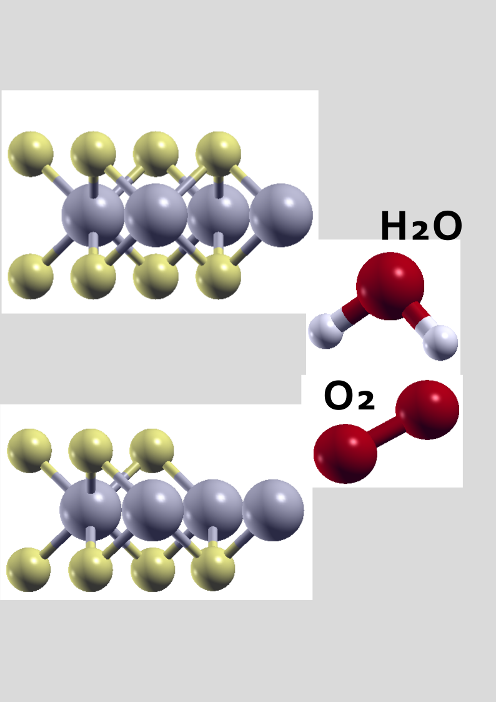

<p align="center">
  
</p>

# Sulfur Vacancy in MoS₂ for O₂ and H₂O Adsorption Using CP2K

A density functional theory (DFT) investigation of sulfur-vacancy engineering in monolayer MoS₂ and its interaction with O₂ and H₂O molecules using CP2K. The study combines adsorption energetics, electronic structure analysis, and preliminary CI-NEB calculations to understand defect-mediated gas sensing behavior.

## Motivation

Pristine MoS₂ is a semiconducting two-dimensional material with promising sensing applications. However, experimentally synthesized MoS₂ often contains sulfur vacancies, which strongly modify its electronic structure and surface reactivity.

Sulfur vacancies introduce defect states within the band gap and may act as active adsorption sites for atmospheric molecules. Understanding how defect sites interact with oxygen and water is important because these species are unavoidable under ambient conditions and can significantly influence sensor performance.


## Research Questions

1. How does sulfur vacancy formation affect the electronic structure of MoS₂?
2. Does O₂ interact more strongly with sulfur vacansies than H₂O?
3. Can O₂ adsorption passivate vacancy-induced defect states?
4. Is O₂ activation at the vacancy sufficient to promote dissociation?

## Methodology

### 1. Geometric Optimization
- DFT calculations performed using CP2K.
- PBE exchange-correlation functional.
- DFT-D3 dispersion correction.
- Periodic 2x2 MoS₂ supercell.
- Optimization performed for MoS₂ (pristine), MoS₂ (sulfur vacancy), Molecule pristine (O₂ and H₂O), Vacancy + Molecule (O₂ and H₂O)

### 2. Electronic Structure
- Density of States (DOS).
- Band Structure.
- Band-gap extraction from occupied an unoccupied states.

### 3. Adsorption Energy
Adsorption energy was calculated as 

Eads = E(system+molecule) - Esystem - Emolecule

Negative values indicated favorable adsorption.

### 4. Preliminary CI-NEB
A preliminary climbing-image nudged elastic band (CI-NEB) calculation was performed to explore the dissociation pathway:

O₂* --> 2O*

at the sulfur-vacancy site. 


## Systems Studied

| System | Purpose |
|---|---|
| Pristine MoS₂  | Electronic structure reference |
| S-vacancy MoS₂  | Defect-state investigation |
| S-vacancy + H₂O  | Weakly interacting adsorbate |
| S-vacancy + O₂  | Reactive adsorbate |

## Key Results

### Adsorption Energy 

| Adsorbate | Eads (eV) |
|---|---|
| H₂O | −0.15 |
| O₂ | **−3.21** |

O₂ adsorption is more than twenty times stronger than H₂O adsorption, indicating strong defect-mediated selectivity toward oxygen.

### Electronic Structure

| System | Band Gap (eV) |
|---|---|
| Pristine MoS₂  | 1.54 |
| S-vacancy MoS₂ | 0.26 |
| S-vacancy + H₂O  | 0.14 |
| S-vacancy + O₂  | 0.98 |

Sulfur vacancies drastically reduce the band gap by introducing defect states. Oxygen adsorption partially restores the electronic gap, indicating passivation of vacancy-induced states.

### O₂ Activation

| Property | Value (Å) |
|---|---|
| Free O₂ bond length  | ~1.21 |
| Adsorbed O₂ bond length | ~1.36 |

### Preliminary CI-NEB

The partially converged reaction pathway suggests:

- A dissociation barrier on the order of ~1 eV.
- A final dissociated state approximately 1 eV lower in energy than the molecularly adsorbed state.

These results should be interpreted as qualitative indications because the CI-NEB calculation was not fully converged.

## Answers to the Research Questions

**Q1 — Effect for sulfur vacancies:** Sulfur vacancies introduce defect states and reduce the band gap from 1.54 eV to 0.26 eV.

**Q2 — Relative adsorption strength:** O₂ adsorbs much more strongly than H₂O (-3.21 eV vs -0.15 eV).

**Q3 — Vacancy passivation:** O₂ adsorption partially passivates vacancy-induced defect states and reopens the band gap to 0.98 eV.

**Q4 - O₂ dissociation:** Preliminary CI-NEB calculations indicate that O₂ activation may lead to dissociation through a moderate reaction barrier (~1 eV).

## Limitations

- Charge-transfer analysis was not performed.
- PDOS decomposition was not performed.
- The reported CI-NEB barrier corresponds to a partially converged pathway.
- Larger supercells may further reduce defect-defect interactions due to periodic boundary conditions.

## Repository Structure

```
mos2-vacancy-gas-sensing/
├── README.md
├── inputs/
│   ├── pristine/
│   ├── vacancy/
│   ├── h2o/
│   ├── o2/
│   └── neb/
├── structures/
├── figures/
├── scripts/
└── results/
```

## Software Used

- [CP2K](https://www.cp2k.org/)
- Python (NumPy, Matplotlib)

## Reproducing the Results

```bash
# CP2K
cd inputs/
mpirun -np 8 cp2k.psmp -i MoS2_optgeo.inp -o MoS2_optgeo.out &
# Plotting
python3 banddos.py

```
